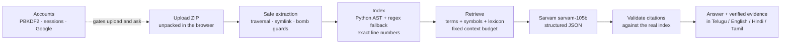

# CodeSathi AI — Hackathon Pitch

**Understand Code. In Your Language.**

---

## The problem

Every student who opens an unfamiliar codebase hits the same wall. They have
thousands of lines of code written by someone else, and the only explanations
available are in English, assume context they do not have, and almost never
say *which file* the behaviour actually lives in.

So they do the slow thing: search, guess, open the wrong file, repeat.

For a student in India who thinks in Telugu, Hindi or Tamil but reads technical
English slowly, that cost doubles. And the obvious shortcut — asking a general
chatbot — makes it worse, because a chatbot will cheerfully describe a `login`
function with confident detail that does not exist in the project in front of
you. The student cannot tell the difference, so they learn something false.

## The solution

CodeSathi AI is a workspace for understanding an unfamiliar project in your own
language, where **every answer arrives with the source code that supports it.**

Upload a ZIP. Ask *"Ee project lo login process ela work avutundi?"*. Get an
explanation in Telugu — and beside it, the actual files, functions and line
numbers it came from, each one clickable, each one landing on real code.

You can browse the bundled sample project with no account at all. An account —
email and password, or Google — is needed only to upload your own repository
and ask about it, so the expensive AI endpoint is never open to anonymous
traffic. The whole thing deploys to Vercel with a hosted Postgres database.

## Why multilingual code understanding matters

Technical English is a filter, and it filters out people who would otherwise be
excellent engineers. The concepts in a codebase — a request entering a route, a
password being verified against a hash, a token being issued — are not
inherently English. Only the explanation is.

Sarvam's model already handles the ten most-spoken Indian languages plus
English in native script, romanised and code-mixed form. So a student can ask
in the mixed register they actually speak — *"ee project lo login ela work
avutundi?"* — and read the answer in Telugu, while the code, identifiers and
file paths stay exactly as they are in the repository.

## What Sarvam contributes

Sarvam is not a translation layer bolted on at the end. It is doing the
reasoning:

- **Code comprehension.** `sarvam-105b` — a 128K-context flagship model
  documented for complex reasoning and coding — reads the retrieved snippets
  and explains the flow.
- **Native multilingual output.** The explanation is written in the target
  language directly, so identifiers stay intact and the prose reads naturally
  rather than like a translated English sentence.
- **Structured output.** The `json_schema` response format constrains the reply
  to a fixed shape — answer, ordered steps, key files, citations, uncertainty,
  follow-ups — which is what makes automatic citation checking possible at all.
  Without structure, you cannot verify anything.

Everything else in the product exists to make that model trustworthy: safe
extraction, real indexing, targeted retrieval, and citation validation.

## Architecture and implementation

**Stack.** React 18 + TypeScript + Vite + Tailwind on the front; Flask on the
back; the official `sarvamai` Python SDK for the model; SQLAlchemy with
Postgres on Vercel and SQLite locally.

**Why the browser unpacks the archive.** A Vercel serverless function is
stateless and caps a request body at ~4.5 MB — smaller than a real repository
archive. So the ZIP is unpacked client-side and the source files are uploaded as
JSON batches. Nothing needs a filesystem, and every request stays small.

**The part worth dwelling on** is step five. A language model will cite things
that do not exist. So every citation is re-checked against the *current*
project index before it is shown: the file must exist, the line range must be
inside the file and correctly ordered, and any quoted text must actually appear
in the cited lines. Anything that fails is displayed separately, marked
unverified, and never presented as evidence.

That single decision is the difference between a demo and a tool a student can
trust.

## Three-minute demo script

**0:00 — The problem (20s).**
Show a real repository file tree. *"This is what a student sees on day one of a
new project. They have to explain it to themselves — usually in their second
language."*

**0:20 — Landing (15s).**
Open the app. Point at the headline and the illustration. *"Understand code, in
your language. With evidence for every answer."*

**0:35 — Browsing is open (20s).**
Click **Explore Your Codebase** → **Load sample project**. No account needed:
*"Browsing a project is open to everyone. Uploading one, and asking about it,
needs an account — that keeps the AI endpoint from being open to anonymous
traffic."* The sample is a real Flask service: login, database config, API
routes, a user model. Point at the sidebar: *"17 files, 424 lines, 15 parsed
with Python's own AST — so every function and class has an exact line range."*
Expand `auth/` and open `login.py`. *"Real line numbers, straight from the
index."*

**0:55 — Sign up (15s).**
Type a question and hit send — it asks you to sign in. Click **Create
account**, enter an email and password, and you land back in the workspace
signed in. *"Email and password, or Google. Passwords are PBKDF2 with 600,000
iterations; sessions are server-side and the cookie is httpOnly."*

**1:10 — Ask in Telugu (45s).**
Type *"Ee project lo login process ela work avutundi?"* and send.
While it works: *"It retrieves the most relevant snippets within a fixed
context budget — it does not send the whole repository — then asks Sarvam's
105B model to explain them, in Telugu, as structured JSON."*

When the answer lands, read the Telugu explanation, then point at the steps,
then at the **Verified source evidence** section.

**1:55 — Click a citation (30s).**
Click `auth/login.py` lines 39–61. The code viewer jumps to those exact lines
and highlights them. *"That is not a citation rendered as text. That is the
real file, at the real lines, checked before it was shown."*

**2:20 — Show the honesty (25s).**
Point at the rejected-citations panel and explain the validation rule. Then ask
something the repository cannot answer — *"How does the payment gateway
integrate?"* — and show that the app says there is not enough evidence rather
than inventing an answer. *"It would rather say 'I don't know' than teach you
something false."*

**2:45 — Close (15s).**
*"Sarvam gives us a model that reasons about code and writes in Indian
languages. We built the trust layer around it: safe uploads, real indexing,
targeted retrieval, verified citations — and accounts, so it is something you
could actually put in front of students. It deploys to Vercel. Understand code,
in your language."*

### If Sarvam is unavailable during the demo

The app is built for this. Without a key, browsing, the file tree, the code
viewer and evidence retrieval all still work, and the ask panel shows a clear,
honest message that AI explanations require a configured API key. Say so
plainly: *"The API key isn't configured on this instance, so you can see the
browsing and retrieval half working, and the app tells you exactly why answers
are unavailable instead of faking one."*

## Evaluation results

Measured on this machine, from actual runs. Nothing here is estimated.

| Check | Command | Result |
| --- | --- | --- |
| Backend test suite | `python -m pytest` | **209 passed** |
| Frontend type-check | `tsc --noEmit` | **No errors** |
| Frontend production build | `npm run build` | **1844 modules → 373.84 kB JS (114.26 kB gzip), 29.92 kB CSS** |
| End-to-end journey, live | `python verify_e2e.py` | **29/29 checks passed**, including the account flow, with a real answer from `sarvam-105b` |
| Live answer quality | 5 real questions | **Correct citations in all 4 answerable cases; the 5th honestly returned nothing** |
| Answer latency, live | same 5 questions | **2–5 s** per answered question |
| UI verification | headless Chromium | Landing (both themes), sign-up, the signed-in workspace, sample load, a rendered Telugu answer with verified citations, and the no-key error state |

The tests cover the parts that are easy to get quietly wrong: path traversal,
symlink and zip-bomb rejection, size and count limits, exact line numbers,
retrieval relevance, citation validation, cross-project citation rejection,
hallucinated citations being flagged, truncation repair, field-name
normalisation, and every Sarvam error path.

**Found by real use, then fixed.** A user uploaded this project as their
repository and asked about login; the answer described *the tool itself*
instead of the login code, because a README that quotes the question outranked
the function that implements it. Fixing that exposed a deeper one: the model
writes `app.config["DATABASE_URL"]` when explaining code, and a raw double
quote inside a JSON string invalidates the reply — after which it stalls for
45–57 s emitting whitespace until it hits the token cap. Both are fixed:

- Structural matches (filename, symbol) now dominate textual ones, files are
  weighted by role, and a relative cutoff drops dilution. The reported case now
  retrieves only the two correct functions.
- Citations no longer ask the model to retype code; the backend reads the
  evidence lines from the file. Plus unescaped-quote repair and one corrective
  retry. Measured on the worst-affected question: **3/8 failures → 0/8**,
  median latency 2.3 s.

Earlier, measurement against the live API also showed reasoning consuming the
whole token budget (empty answers), and `json_schema` making the model pad
indefinitely (46–59 s per answer). Every one of these is covered by tests.

## Limitations and future scope

**Honest limitations.**

- Retrieval is lexical, not semantic. A question sharing no vocabulary with the
  code returns nothing — and the app says so rather than guessing.
- Non-Python languages use a regex scanner. It finds declarations; it does not
  resolve types or call graphs, and the UI labels which parser was used.
- Repositories are capped (25 MB upload, 1500 files, 1.5 MB per file).
- Projects live in memory: a restart clears them. There is no authentication.
- Answer quality depends on what was retrieved; a file the retriever missed
  will produce an honest "not enough evidence".

**Future scope.**

- **Semantic retrieval** — blend embeddings with the lexical score, degrading
  gracefully when no embedding provider is configured.
- **Streaming answers** — the SDK supports `stream=True`; not implemented today,
  so it is not claimed.
- **Symbol call graph** — answer "what calls `login()`?" from the AST.
- **Persistence** — SQLite + SQLAlchemy for projects and sessions.
- **Language quality review** — the bilingual lexicon should be extended and
  the output reviewed by native speakers of Telugu, Hindi and Tamil.
- **Retrieval benchmark** — a question → expected-file set so retrieval changes
  can be measured instead of judged by eye.

---

Built with **Sarvam AI**. Explanations are AI-generated; citations are verified
against your repository, and the ones that fail are labelled unverified.
